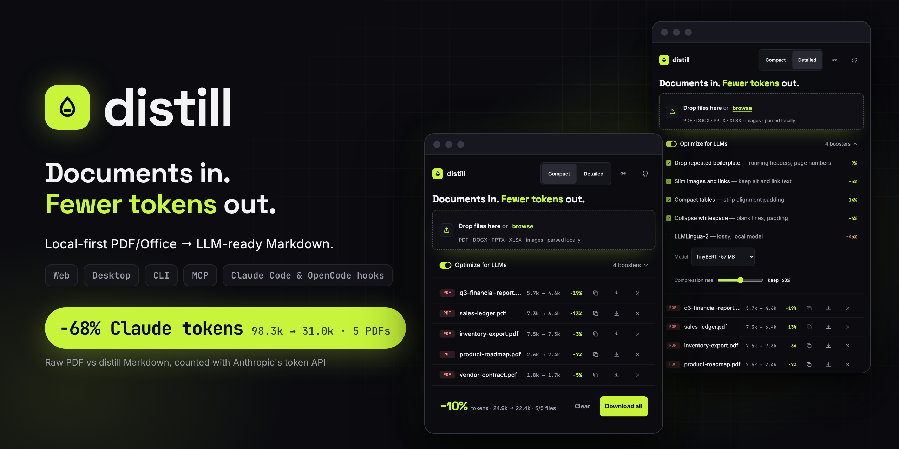
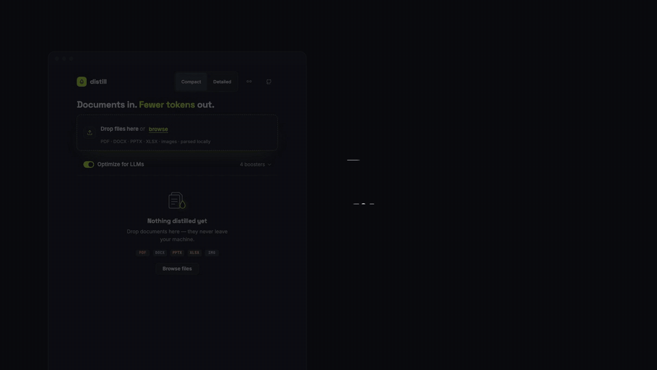
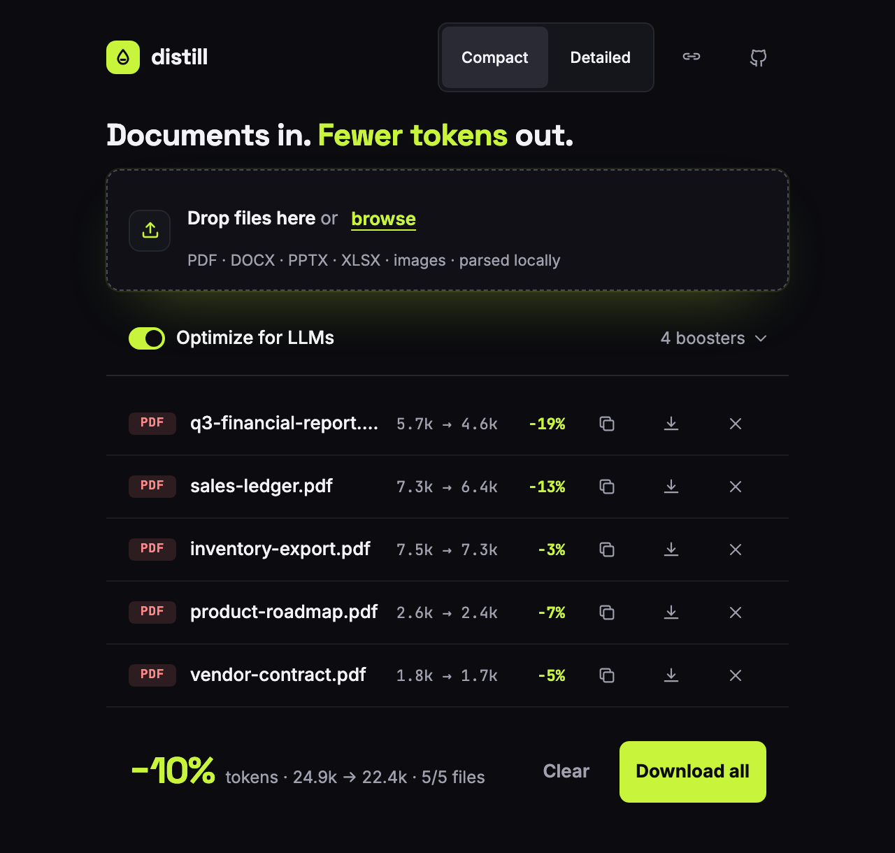
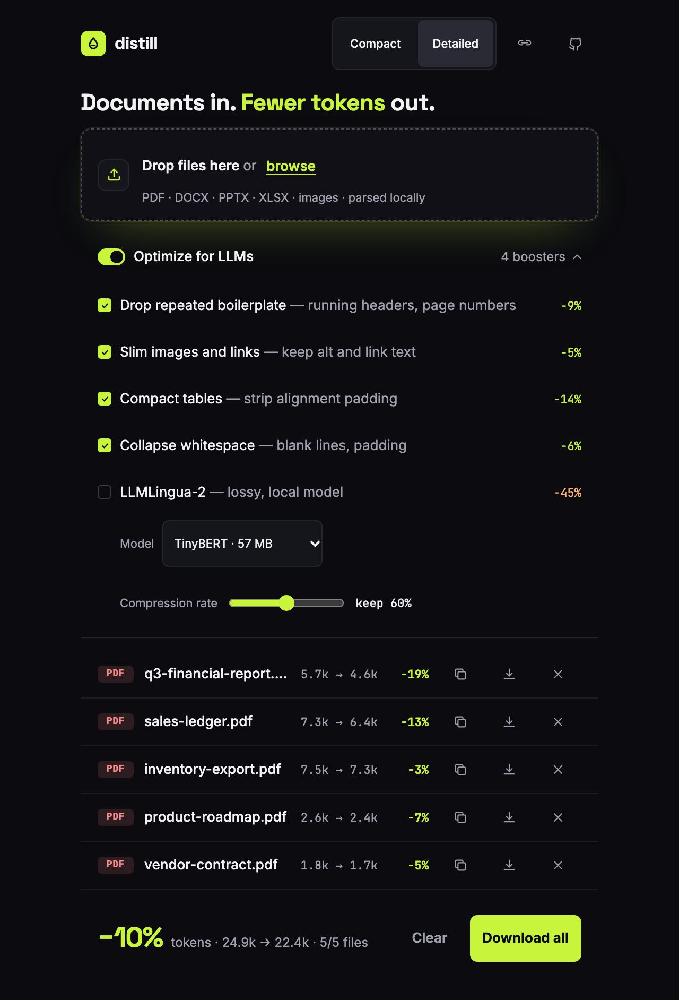
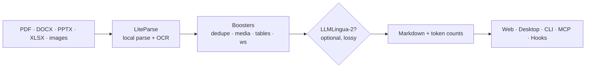

<p align="center">
  
</p>

<p align="center">
  <b>Turn PDFs, Office files and scans into token-lean Markdown for your LLM and your coding agent.</b><br>
  Local-first. No telemetry. Web app, desktop app, CLI, MCP server and Claude Code / OpenCode hooks.
</p>

<p align="center">
  <a href="https://github.com/nievesjesus/distill/actions/workflows/ci.yml"></a>
  <a href="https://www.npmjs.com/package/distill-llm"></a>
  <a href="LICENSE"></a>
  
  
</p>

<p align="center">
  <a href="https://nievesjesus.github.io/distill/">Website</a> ·
  <a href=".github/assets/distill-launch.mp4">Launch video</a> ·
  <a href="#quick-start">Quick start</a> ·
  <a href="#use-it-from-your-agent">Agents (MCP + hooks)</a> ·
  <a href="#faq">FAQ</a>
</p>

<p align="center">
  
</p>

## Why

Coding agents read PDFs the expensive way. We asked Anthropic's token counting API how many input tokens Claude needs for five demo PDFs, once as the raw PDF and once as distill's Markdown:

| Document | Pages | Raw PDF | distill Markdown | Saved |
|---|---:|---:|---:|---:|
| `vendor-contract.pdf` | 7 | 14,021 | 2,829 | **−80%** |
| `product-roadmap.pdf` | 8 | 16,518 | 3,870 | **−77%** |
| `q3-financial-report.pdf` | 12 | 24,978 | 6,357 | **−75%** |
| `inventory-export.pdf` | 9 | 24,091 | 9,871 | **−59%** |
| `sales-ledger.pdf` | 7 | 18,693 | 8,066 | **−57%** |
| **Total** | 43 | **98.3k** | **31.0k** | **−68%** |

<sub>Measured on 2026-11-07 with <code>POST /v1/messages/count_tokens</code> and <code>claude-sonnet-5-5</code>. The documents are generated by <code>scripts/marketing/make-demo-docs.mjs</code> and the numbers are reproducible with <code>npm run marketing:measure</code>. Your files will differ.</sub>

On top of that, distill's lossless boosters trim another 10% from LiteParse's Markdown on the same files (24.9k → 22.4k `o200k_base` tokens). LiteParse already returns clean Markdown, so that extra step is modest; it is bigger on table- and link-heavy documents.

## Features

- **One engine, many doors.** The same local pipeline behind a web app, a desktop app, a Docker image, a CLI, an MCP server and hooks for Claude Code and OpenCode.
- **Real parsing.** [LiteParse](https://github.com/run-llama/liteparse) by LlamaIndex reads PDFs, DOCX, PPTX, XLSX, ODF and images (with OCR).
- **Lossless boosters.** Small, deterministic passes drop repeated boilerplate, image paths and link targets, table padding and extra whitespace. Content words stay.
- **Optional LLMLingua-2.** A local model for when you want to go further and accept a lossy result. Off by default, installed on demand.
- **Honest numbers.** Every file's before and after token counts come from a real tokenizer, live in the UI.
- **Private by design.** Files are parsed on your machine. No telemetry, no analytics, no CDN.

## Quick start

```bash
npx distill-llm
```

This starts a local server at `http://127.0.0.1:4321` and opens the web UI. Drop files in, read the Markdown, copy it or download it (one `.md` or a ZIP of all of them).

<p align="center">
  
  &nbsp;
  
</p>

## Use it from your agent

### MCP server

Give any MCP client three tools: `distill_file`, `distill_files` and `distill_capabilities`.

```bash
claude mcp add distill -- npx -y distill-llm mcp
```

Any other client:

```json
{
  "mcpServers": {
    "distill": { "command": "npx", "args": ["-y", "distill-llm", "mcp"] }
  }
}
```

`distill_file({ path, boosters?, lingua? })` returns the Markdown plus `{ tokens: { raw, out }, pages, kind }`. `distill_files` takes up to 20 paths and reports a per-file error instead of failing the whole call.

For clients that speak HTTP, `distill-llm mcp --http` serves Streamable HTTP at `http://127.0.0.1:4322/mcp`. Over HTTP the server only reads files inside the directories you pass with `--root` (repeatable, default: the current directory) and compares real paths, so symlinks cannot escape. It rejects cross-site requests and answers only to loopback names, IP addresses and the hostnames you list with `--allowed-hosts`, which blocks DNS rebinding.

<details>
<summary>Remote clients such as ChatGPT connectors</summary>

The HTTP server has **no authentication**: anyone who can reach it can read every file under `--root`. Never publish it directly to the internet. To use it from a remote client:

1. Point `--root` at a folder that holds only the documents you want to share.
2. Put an HTTPS tunnel **with authentication** in front of it (for example Cloudflare Tunnel with Cloudflare Access, or Tailscale Funnel restricted to your tailnet).
3. Allow the tunnel's hostname, or every request gets 403:

```bash
distill-llm mcp --http --root ~/shared-docs --allowed-hosts distill.example.com
```

4. Add `https://distill.example.com/mcp` as the connector URL in your client.
</details>

### Hooks: make your agent read Markdown instead of the binary

```bash
npm i -g distill-llm
distill-llm hooks install --claude     # Claude Code
distill-llm hooks install --opencode   # OpenCode
```

- **Claude Code:** adds a `PreToolUse` hook on `Read` to `~/.claude/settings.json` (or your personal `.claude/settings.local.json` with `--project`). When Claude reads a PDF inside the project it is working in, the hook converts it once, caches it by content hash in `~/.cache/distill-llm/out/` (private to your user) and points the read at the Markdown. It also adds the permission rule `Read(~/.cache/distill-llm/out/**)` so those reads do not prompt. Claude Code refuses Office files before any hook runs (checked on Claude Code 2.1.296), so the installer also writes the skill `distill-office-documents` to `~/.claude/skills/` (or `.claude/skills/` with `--project`). It has Claude run `distill-llm convert --stdout` through Bash for `.docx`, `.doc`, `.xlsx`, `.xls`, `.pptx`, `.ppt`, `.odt`, `.ods` and `.odp` files. Claude Code asks before each of those Bash calls unless you allow it; distill does not add that permission, because Bash is not subject to `Read` deny rules. A `SKILL.md` you wrote yourself is left alone.
- **OpenCode** (experimental): writes a plugin to `~/.config/opencode/plugins/distill.js` (or `.opencode/plugins/` with `--project`) that does the same on `tool.execute.before` for `read`. OpenCode's plugin API is changing; if the plugin does not apply, OpenCode simply reads the original file.

The installer shows the exact change and asks before writing (`--yes` skips the question). It keeps your other settings, follows symlinked dotfiles, keeps the file mode, and masks existing values in the diff it prints. `distill-llm hooks uninstall --claude|--opencode` removes only what it added, including the skill. Install it globally first: a command written from a temporary `npx` run would disappear.

The hooks respect your permissions and never block a read:

- Files outside the project the agent works in are not converted, so Claude Code asks you about them as usual.
- The Claude Code hook steps aside when a `deny` or `ask` rule for `Read` in your user, project (any parent folder or `CLAUDE_PROJECT_DIR`), local or managed settings could match the file being read (or its real path) or distill's cache. Relative rules are checked against the working directory and the folder that holds the settings file. A rule it cannot interpret (character classes, braces, `!`, `$`, a `~` without `/`, `.` or `..` segments) counts as matching. If a settings file can't be read, the hook stays out of the way entirely. Rules passed on the command line (`--settings`, `--disallowedTools`) are invisible to hooks.
- Images and CSV files are left alone.
- If anything fails (a missing file, a timeout, a password-protected PDF, a scan with no text), the agent reads the original file.

Set `DISTILL_HOOK=off` to disable the Claude Code hook for a session.

### CLI

```bash
npx distill-llm convert report.pdf deck.pptx --out md/
```

| Option | Does |
|---|---|
| `--out <dir>` | Write the `.md` files into a directory (default: next to each input) |
| `--boosters <list>` | Only these boosters: `dedupe`, `media`, `tables`, `ws` |
| `--no-optimize` | Plain LiteParse Markdown, no boosters |
| `--lingua [--rate 0.5]` | Add LLMLingua-2 (must be installed from the web app first) |
| `--json` | Print a JSON array with tokens, pages and timings per file |
| `--stdout` | Print the Markdown of a single file instead of writing it |

`distill-llm update [--yes]` checks for a newer version right away. A global npm install updates after a y/N question (or straight away with `--yes`); other installs print the command to run. After `convert` on a terminal, and when the web app starts, a one-line notice goes to stderr if a newer version exists (never with `--json` or `--stdout`).

Each file prints a summary such as `report.pdf → report.md  5.7k → 4.6k tokens (−19%)`. The exit code is 1 if any file failed; the others are still converted.

## Desktop app and Docker

**Desktop:** installers for macOS (arm64, x64), Windows (x64) and Linux (x64) are on [GitHub Releases](https://github.com/nievesjesus/distill/releases). They are named without a version (`Distill-lite-mac-arm64.dmg`, `Distill-lite-mac-x64.dmg`, `Distill-lite-win-x64.exe`, `Distill-lite-linux-x86_64.AppImage`), so `https://github.com/nievesjesus/distill/releases/latest/download/<file>` always points at the newest release. `Distill-lite-*` has everything except LLMLingua-2; `Distill-full-*` bundles its runtime and is published for Apple Silicon, Windows x64 and Linux x64. Intel Macs get the lite build only.

<details>
<summary>Unsigned installers: how to open them the first time</summary>

- **macOS 15 and later:** open the app once and dismiss the warning, then go to System Settings > Privacy & Security and click **Open Anyway**.
- **macOS 14 and earlier:** right-click the app, choose **Open**, then confirm **Open**.
- **"The app is damaged":** run `xattr -dr com.apple.quarantine /Applications/distill.app` and open it again.
- **Windows:** in the SmartScreen dialog click **More info**, then **Run anyway**.

Release builds are signed when the signing certificates are configured; if your installer is unsigned, the steps above apply. The desktop app has no auto-update. OCR data is bundled; Office files still need LibreOffice installed.
</details>

**Docker:** LibreOffice and the English OCR data are included, so every format works out of the box.

```bash
docker run --rm -p 4321:4321 -v distill-cache:/home/node/.cache ghcr.io/nievesjesus/distill
```

Open it as `http://localhost:4321` or by IP, or pass `-e DISTILL_ALLOWED_HOSTS=<name>` to reach it by hostname. Build it yourself with `docker build -t distill .`.

## How it works



| Booster | What it does | Loss |
|---|---|---|
| Drop repeated boilerplate | Removes identical running header/footer lines (4+ words, 25+ chars, 3+ repeats) and page-number lines such as `Page 3 of 12`. Lines that differ in any character are kept. | None |
| Slim images and links | `` becomes `[alt]`, `[text](url)` becomes `text` | Drops image paths and URLs |
| Compact tables | Removes alignment padding from GFM tables | None |
| Collapse whitespace | Collapses blank-line runs, trailing and double spaces outside code | None |
| LLMLingua-2 | A local model removes low-value words | **Lossy**, off by default |

Boosters are pure, idempotent functions and never touch fenced code blocks or front matter. In the web app they run in your browser, so switching one on or off updates the counts instantly. If you need link targets, turn off "Slim images and links".

<details>
<summary>LLMLingua-2 details</summary>

LLMLingua-2 is optional and experimental. It needs Apple Silicon, Windows x64 or Linux x64: its ONNX runtime has no Intel Mac build, so on Intel Macs the row explains this instead of offering an install. When `npm` is available, its row shows **Install (~520 MB)**: one click runs `npm ci --omit=dev --include=peer --ignore-scripts` against a lockfile with pinned versions and integrity hashes and installs the runtime into `~/.cache/distill-llm/lingua`. The first use downloads the model (TinyBERT, about 57 MB) from Hugging Face into `~/.cache/distill-llm/models`; after that it runs offline. Behind a proxy that intercepts HTTPS, give Node your organization's CA with `NODE_EXTRA_CA_CERTS=/path/to/ca.pem`. Never turn off certificate checks.
</details>

## Supported formats

| Format | Needs |
|---|---|
| PDF | nothing else |
| PNG, JPG, TIFF, WebP | nothing else (OCR built in; English data is downloaded once, about 15 MB) |
| DOCX, PPTX, XLSX, ODF | [LibreOffice](https://www.libreoffice.org/download/) on your `PATH` (`soffice`); included in Docker |

Password-protected PDFs are reported as an error. Parsing quality is whatever LiteParse gives you: it varies on dense tables and complex scans, and distill does not try to hide that.

## Privacy

Files are parsed locally and never leave your machine. There is no telemetry, no analytics and no CDN: fonts are bundled. distill makes at most three one-time downloads, all of data and never of your documents: the Tesseract English data for the first OCR (skip it with `DISTILL_TESSDATA` or `TESSDATA_PREFIX`; `DISTILL_OCR_LANG` sets the language), and, only if you enable LLMLingua-2, its runtime from npm and its model from Hugging Face.

Once a day distill also asks `registry.npmjs.org` for the latest `distill-llm` version, sending only its own version in the User-Agent, and caches the answer in `~/.cache/distill-llm/update-check.json`. Turn it off with `DISTILL_NO_UPDATE_CHECK=1` or in the web app (click the version in the header, then "Check for updates daily"). The hooks and the MCP server never check.

Uploaded files go to a temporary directory and are deleted after parsing. Results stay in a small in-memory cache so the JSON view can be requested later. The hooks write converted Markdown to `~/.cache/distill-llm/out/`. API responses are sent with `Cache-Control: no-store`.

<details>
<summary>Network exposure</summary>

The web server only listens on loopback by default. `--host 0.0.0.0` exposes it to your network and disables the loopback check, so only do that on a network you trust: there is no authentication. On every host, state-changing `/api` requests are rejected when the browser marks them cross-site or when their `Origin` differs from the `Host`. When exposed, the server only answers to loopback names, IP addresses and the hostnames you list with `--allowed-hosts` or `DISTILL_ALLOWED_HOSTS`, which blocks DNS rebinding. A reverse proxy must keep the original `Host` header.
</details>

## How tokens are counted

The app and the CLI count with `o200k_base` (via `gpt-tokenizer`). Claude and Gemini tokenize differently, so absolute counts are approximate, while the percentage saved is comparable across tokenizers. The Claude numbers at the top of this page come from Anthropic's own token counting API.

## FAQ

**Is it free?** Yes. Apache-2.0, no account, no paid tier.

**Does anything leave my machine?** Your documents never do. See [Privacy](#privacy) for the optional one-time data downloads.

**How do I update?** The web app and the CLI tell you when a new version exists. With a global npm install, click **Update** in the web app (loopback only) or run `distill-llm update`, then restart distill. With npx, run `npx distill-llm@latest`. With Docker, run `docker pull ghcr.io/nievesjesus/distill`. The desktop app does not update itself yet: download the new installer from [GitHub Releases](https://github.com/nievesjesus/distill/releases).

**Why not just give the PDF to the model?** You can, and for charts and layout-heavy pages you sometimes should. For text, the same content as Markdown costs a fraction of the tokens: about a third on our demo files.

**Will the hook break my agent?** No. It only touches PDF reads inside your project (Office files go through the skill and a Bash call you approve), never blocks a read, steps aside when a `Read` deny or ask rule could match, and falls back to the original file on any error.

**Is LLMLingua-2 safe to use on contracts?** It is lossy by design: it removes words. Keep it off when every word matters.

## Roadmap

- [x] Web app, desktop app and Docker image
- [x] CLI (`distill-llm convert`)
- [x] MCP server (stdio and HTTP)
- [x] Hooks for Claude Code and OpenCode
- [ ] Signed and notarized desktop builds
- [ ] Hooks for more agents as their hook APIs settle (Codex, Gemini CLI)
- [ ] Password-protected PDFs

Ideas and votes are welcome in [Issues](https://github.com/nievesjesus/distill/issues).

## Contributing

```bash
git clone https://github.com/nievesjesus/distill && cd distill
npm ci
npm test            # unit tests
npm run typecheck
npm run build
npm run test:e2e    # Playwright, web app
npm run test:smoke  # built CLI: convert, MCP, hooks
```

See [CONTRIBUTING.md](CONTRIBUTING.md). `npm run marketing` regenerates the demo documents, screenshots and banner from the real app.

<details>
<summary>Building the desktop app</summary>

Build one architecture per host: `npm run dist:full -- --arm64` on Apple Silicon or `npm run dist:full -- --x64` on Windows or Linux (Intel Macs only get `dist:lite`). `build/lingua` holds only the sharp binary of the machine that ran `npm ci`, so a cross-architecture installer would ship the wrong native module. Re-running the release workflow for a tag whose draft release already exists does not replace its installers; delete the draft first.
</details>

## License

[Apache-2.0](LICENSE). Built on [LiteParse](https://github.com/run-llama/liteparse) by LlamaIndex.

If distill saves you tokens, a ⭐ helps other people find it.
